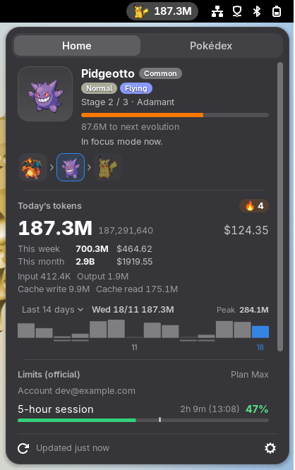
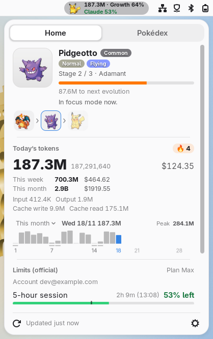
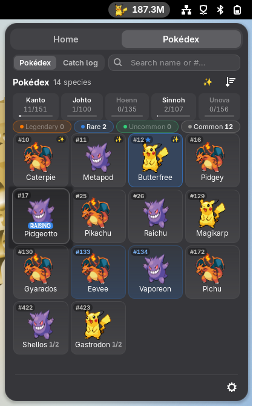
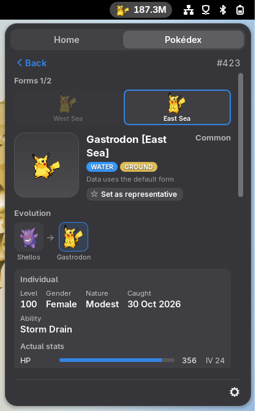

# PokeTokenBar-GNOME

Port of [PokeTokenBar](https://github.com/chattymin/PokeTokenBar) (macOS) to GNOME Shell 51 on Fedora Linux.
It tracks Claude Code token usage and turns it into a Pokémon companion in the top bar.

**Status:** Milestone 1 complete, current version 0.1.1 (Claude Code only).

## Features (Milestone 1)

- **Top-bar indicator:** the animated companion sprite plus optional labels (tokens, cost, official
  limit %, growth %), colored by pace. Right-click opens a menu.
- **Popover home:** companion card (rarity, nature, growth progress, evolution line), today / week /
  month tokens and cost, a daily bar chart (7 / 14 / 21 days or the month, hover tooltip), and the
  official Claude limits with a pace marker, reset countdown and forecast.
- **Companion:** egg, hatch, evolve, graduate. Candies accrue from limit windows.
- **Pokédex:** paged grid with search, rarity / region / shiny filters and sorting; species detail with
  forms, the individual's profile and stats, and *Set as representative*; a paged catch log; region badges.
- **Notifications** for limit alerts (warn / critical) and companion events.
- **Preferences** (libadwaita) for every setting above.

## Screenshots

Rendered in an isolated sandbox shell from **fixture data** (a protocol stub, not a real account).
The numbers are sample values and the sprites are placeholder drawings, not real Pokémon art.

| Home (dark) | Home (light) |
|---|---|
|  |  |

| Pokédex | Species detail |
|---|---|
|  |  |

## Install

### From RPM (recommended)

Fedora, system-wide. Build requirements: `sudo dnf install rpm-build golang`.

```
make rpm
sudo dnf install dist/gnome-shell-extension-poketokenbar-*.rpm
```

Upgrading to a newer version: `sudo dnf upgrade dist/...rpm`. To reinstall the same version
(rebuilt from the working tree), use `sudo dnf reinstall dist/...rpm`.

Then log out and back in (Wayland cannot reload extensions), and run:

```
gnome-extensions enable poketokenbar@local
```

A per-user copy from `make install` in `~/.local/share/gnome-shell/extensions/` takes precedence over
the system one, so run `make uninstall` first.

### From source (per user)

```
make install   # builds, then copies the extension to ~/.local/share/gnome-shell/extensions/poketokenbar@local
```

Log out and back in, then enable the extension as above.

### Pack

`make pack` writes `dist/poketokenbar@local.zip` (extension, schemas and the `bin/ptb-helper` binary, no
tests). extensions.gnome.org does not accept bundled binaries, so this zip is for manual installs
only (`gnome-extensions install`).

## Configuration

Open preferences from the gear in the popover footer, or right-click the indicator and choose **Settings…**. Settings: refresh
interval, animation quality, menu-bar items and limit color mode, used or remaining limits, chart
period, week start, growth difficulty, warn / critical thresholds, and notification toggles.

## Floating pet and agent bubbles

Turn it on in **Settings → Floating pet**, from the indicator's right-click menu, or with the eye in
the popover footer. Your Pokémon then stands over your windows, under the top bar, menus and
notifications.

- **Drag** it anywhere; the spot is saved when you let go and kept inside the screen's work area.
  It starts in the bottom-right corner and comes back there if its monitor is unplugged.
- **Hover** shows today's tokens and the highest limit; **stroke** it side to side for a heart;
  **click** opens the popover; **right-click** offers *Open Token Bar*, *Turn off floating pet* and
  *Show back view*.
- Limit alerts pop up as a speech bubble for 6 s (**Show notifications as bubbles**, independent of
  the notification setting), and hatches, evolutions and medals show their line in the callout.
- It hides in the overview, over fullscreen windows and while the display sleeps. With animations
  off or the power-saver profile on, bubbles still show but the pet does not move.

**Agent activity.** Coding agents report to the extension over the session bus: the pet bobs while
an agent works, asks for you in a bubble when it waits, and runs to your pointer when it is done.

| Item | Value |
|---|---|
| Name | `io.github.poketokenbar.Agent` |
| Object | `/io/github/poketokenbar/Agent` |
| Method | `io.github.poketokenbar.Agent1.Report(state, label, message)` |

- `state` is `working`, `waiting`, `done` or `idle`. `label` (up to 24 characters) names the agent so
  several can run at once; `message` (up to 80) is shown for `waiting` and `done`. Empty strings mean
  none.
- `working` falls back to idle after 10 minutes without news; `done` shows for 6 seconds, then the
  pet walks home; `waiting` stays until that agent's next report or a click on the pet. A click
  clears every question and still opens the popover. Up to 8 labels are tracked.
- Reports are dropped while the pet or **React to agent activity** is off, and reports sent while the
  screen is locked are lost (the shell disables extensions on lock).
- `OpenUrl(s)` accepts the upstream `poketokenbar://agent?state=…&label=…&message=…` form. No URL
  handler is installed.

**Claude Code.** Setup is manual: PokeTokenBar never edits your agent settings. Add these hooks to
`~/.claude/settings.json`. Each labels the session with its project folder. `|| true` keeps a hook
quiet when the extension is off (the name is then not owned and `busctl` fails at once). The
`Notification` matcher skips Claude Code's idle reminder, which would otherwise leave a "waiting"
bubble after every turn. `Stop` does not fire when you interrupt a turn (Esc), so the pet keeps
working until the 10-minute timeout or an `idle` report.

```json
{
  "hooks": {
    "UserPromptSubmit": [{ "hooks": [{ "type": "command", "command": "busctl --user call io.github.poketokenbar.Agent /io/github/poketokenbar/Agent io.github.poketokenbar.Agent1 Report sss working \"${CLAUDE_PROJECT_DIR##*/}\" '' >/dev/null 2>&1 || true" }] }],
    "PostToolUse": [{ "matcher": "*", "hooks": [{ "type": "command", "command": "busctl --user call io.github.poketokenbar.Agent /io/github/poketokenbar/Agent io.github.poketokenbar.Agent1 Report sss working \"${CLAUDE_PROJECT_DIR##*/}\" '' >/dev/null 2>&1 || true" }] }],
    "PreToolUse": [{ "matcher": "AskUserQuestion", "hooks": [{ "type": "command", "command": "busctl --user call io.github.poketokenbar.Agent /io/github/poketokenbar/Agent io.github.poketokenbar.Agent1 Report sss waiting \"${CLAUDE_PROJECT_DIR##*/}\" '' >/dev/null 2>&1 || true" }] }],
    "Notification": [{ "matcher": "permission_prompt|elicitation_dialog", "hooks": [{ "type": "command", "command": "busctl --user call io.github.poketokenbar.Agent /io/github/poketokenbar/Agent io.github.poketokenbar.Agent1 Report sss waiting \"${CLAUDE_PROJECT_DIR##*/}\" '' >/dev/null 2>&1 || true" }] }],
    "Stop": [{ "hooks": [{ "type": "command", "command": "busctl --user call io.github.poketokenbar.Agent /io/github/poketokenbar/Agent io.github.poketokenbar.Agent1 Report sss done \"${CLAUDE_PROJECT_DIR##*/}\" '' >/dev/null 2>&1 || true" }] }]
  }
}
```

Use `busctl`, not `gdbus call`: `gdbus` parses its arguments as GVariant text and would strip quotes
from a label such as `'x'`.

**Other agents** can call the same method, for example
`busctl --user call io.github.poketokenbar.Agent /io/github/poketokenbar/Agent io.github.poketokenbar.Agent1 Report sss done my-app "Build passed" || true`.

## Data locations

| What | Where |
|---|---|
| Save and state | `~/.local/state/poketokenbar/` |
| Usage cache, PokéAPI cache, sprites | `~/.cache/poketokenbar/` |
| Override for both (tests, dev) | `PTB_STATE_DIR` |

## Privacy and network

- The helper reads your Claude Code logs under `~/.claude` (or `$CLAUDE_CONFIG_DIR`) locally. Nothing
  from them is uploaded.
- It reads the Claude OAuth token from `.credentials.json` read-only, only to call the official usage
  endpoint. It never refreshes the token (a refresh would log Claude Code out). Token values are
  never logged.
- Network access is limited to:
  - `api.anthropic.com` (the official usage endpoint);
  - `pokeapi.co` and `graphql.pokeapi.co` (species data);
  - `raw.githubusercontent.com` (the PokéAPI sprite repository).

## Known limitations

- Claude Code only; English UI (strings are wrapped for translation).
- Official limits go stale when Claude Code is idle longer than the token lifetime (the token is never
  refreshed).
- Notifications are cleared on screen lock, because the shell disables extensions then.
- Not yet ported: shop, bag and Rare Candy use, usage recap. See `SPEC.md`.
- The floating pet does not pray over the egg yet: a click on the egg opens the popover.

## Development

```
make build        # helper binary + compiled schemas
make test         # go test -race ./... and the gjs -m unit tests
make lint         # go vet, gofmt, JS syntax check
make run-nested   # nested dev shell (needs mutter-devkit); see warning below
make rpm          # Fedora package
```

Never start `gnome-shell` by hand for tests. `scripts/headless-shell.sh` is the only sanctioned
launcher: it isolates the runtime dir, XDG dirs, GSettings and helper state, and checks that the live
session is untouched (see `tasks/lessons.md`). Sandbox copies of the extension against a protocol stub
are built with `extension/test/prepare-sandbox.sh`; that is how the screenshots above were made.
`make run-nested` shares the live runtime dir and can detach the document portal mount.

## Architecture

- `helper/`: `ptb-helper`, a Go process (stdlib only) that does log scanning, HTTP and game state.
- `extension/`: the GJS extension. It only renders state and sends commands.
- Transport: newline-delimited JSON (NDJSON) over the helper's stdin/stdout. See `docs/protocol.md`.

The helper exists because the extension runs on the compositor's main thread, where heavy parsing would freeze the session.
Specs live in `docs/spec/`; see `SPEC.md`.

## Disclaimer

Unofficial, non-commercial fan project. Pokémon and Pokémon names are trademarks of Nintendo,
Creatures Inc. and GAME FREAK inc. Sprites and data are fetched at runtime from
[PokéAPI](https://pokeapi.co) and are not bundled.

## License

MIT, see `LICENSE`.
